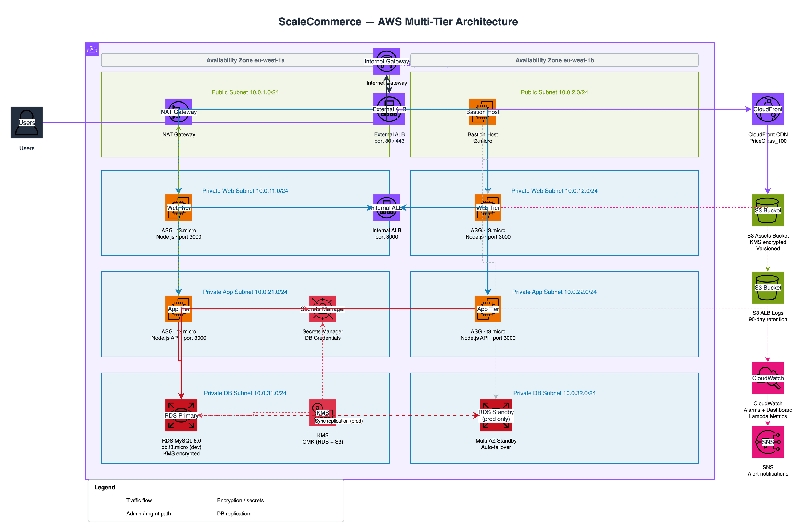

# scalable-ecommerce

Multi-tier e-commerce infrastructure on AWS, provisioned with Terraform. The architecture separates concerns across three compute tiers behind load balancers, with a managed MySQL database, CloudFront-backed static asset delivery, and full observability through CloudWatch.

This was built to solve a specific problem: how do you design an AWS environment that handles unpredictable traffic spikes (think flash sales and seasonal peaks) without over-provisioning for baseline load? The answer here is Auto Scaling Groups triggered by CloudWatch CPU alarms, sitting behind Application Load Balancers, with the database tier completely isolated from the internet.

---

## Architecture



> Source: [`docs/architecture.drawio`](./docs/architecture.drawio) — open in [draw.io](https://app.diagrams.net/) or the VS Code Draw.io extension to edit.

Network layout across two availability zones:

| Subnet Tier   | AZ-1           | AZ-2           |
|---------------|----------------|----------------|
| Public        | 10.0.1.0/24    | 10.0.2.0/24    |
| Web (private) | 10.0.11.0/24   | 10.0.12.0/24   |
| App (private) | 10.0.21.0/24   | 10.0.22.0/24   |
| DB (private)  | 10.0.31.0/24   | 10.0.32.0/24   |

---

## Stack

| Component     | Technology                                      |
|---------------|-------------------------------------------------|
| IaC           | Terraform >= 1.9, modular structure             |
| Compute       | EC2 Auto Scaling Groups, Amazon Linux 2023      |
| Load balancing| Application Load Balancer (external + internal) |
| Database      | RDS MySQL 8.0, KMS-encrypted, Secrets Manager   |
| CDN           | CloudFront + S3                                 |
| Monitoring    | CloudWatch dashboards, SNS alarms, Lambda metrics|
| Security      | Security Groups, NACLs, IMDSv2, KMS, IAM roles  |
| CI/CD         | GitHub Actions (plan on PR, apply on merge)     |

---

## Repository Structure

```
.
├── terraform/
│   ├── backend/              S3 + DynamoDB for remote state
│   ├── main.tf               Root module — wires all modules together
│   ├── variables.tf          All input variables with descriptions
│   ├── providers.tf
│   ├── terraform.tfvars.example
│   └── modules/
│       ├── vpc/              VPC, subnets, IGW, NAT gateways, route tables
│       ├── security/         Security groups and NACLs for all tiers
│       ├── compute/          ALBs, launch templates, ASGs, bastion
│       │   └── scripts/      EC2 user-data for web, app, and bastion
│       ├── database/         RDS instance, parameter group, KMS key
│       ├── storage/          S3 buckets, CloudFront distribution
│       └── monitoring/       CloudWatch alarms, dashboard, Lambda metrics
│           └── lambda/
├── scripts/
│   ├── setup.sh              One-time setup: backend, key pair, tfvars
│   ├── deploy.sh             Plan and apply infrastructure
│   ├── destroy.sh            Tear down with confirmation gate
│   ├── health-check.sh       HTTP checks across all endpoints
│   ├── load-test.sh          Traffic generation using hey
│   └── help.sh               Script usage reference
└── .github/
    └── workflows/
        ├── terraform-plan.yml        Runs on pull requests
        ├── terraform-apply.yml       Runs on merge to main
        ├── security-scan.yml         Checkov, TFSec, TruffleHog
        └── destroy-infrastructure.yml Manual trigger with confirmation
```

---

## Getting Started

### Prerequisites

- AWS CLI configured (`aws configure`)
- Terraform >= 1.9 (`terraform -version`)
- `jq`

### First-time setup

```bash
git clone https://github.com/Analo/scalable-ecommerce.git
cd scalable-ecommerce
chmod +x scripts/*.sh

# Creates the S3+DynamoDB state backend, generates terraform.tfvars,
# imports an SSH key pair, and runs terraform init
./scripts/setup.sh
```

### Review variables before deploying

```bash
# Open and check the generated file — especially:
#   - allowed_ssh_cidr_blocks (should be your IP, not 0.0.0.0/0)
#   - alert_email (optional but useful for CloudWatch notifications)
vim terraform/terraform.tfvars
```

### Deploy

```bash
./scripts/deploy.sh       # shows the plan, prompts before applying
./scripts/health-check.sh # verify endpoints are responding
```

### Tear down

```bash
./scripts/destroy.sh      # double confirmation required
```

---

## CI/CD

The GitHub Actions workflows use OIDC to assume an IAM role — no long-lived credentials stored in secrets.

Required repository secrets:

| Secret            | Value                                              |
|-------------------|----------------------------------------------------|
| `AWS_ROLE_ARN`    | IAM role ARN for GitHub Actions (OIDC)             |
| `AWS_REGION`      | Target region, e.g. `us-east-1`                    |
| `AWS_ACCOUNT_ID`  | 12-digit account ID                                |
| `TF_STATE_BUCKET` | S3 bucket for Terraform state                      |
| `TF_LOCK_TABLE`   | DynamoDB table for state locking                   |
| `KEY_PAIR_NAME`   | EC2 key pair name                                  |
| `AMI_ID`          | Amazon Linux 2023 AMI for the target region        |

See [DEPLOYMENT.md](./DEPLOYMENT.md) for the full OIDC role setup.

---

## Security Design

Traffic between tiers is enforced at two levels — security groups (stateful, instance-level) and NACLs (stateless, subnet-level):

- The external ALB accepts 80 and 443 from the internet; everything else is blocked
- Web tier instances only accept traffic from the external ALB security group; no public IP assigned
- App tier instances only accept traffic from the internal ALB security group
- RDS only accepts port 3306 from the app tier and the bastion — no internet route exists at the subnet level either
- IMDSv2 required on all EC2 instances (blocks SSRF-based metadata access)
- Database credentials managed in Secrets Manager and fetched at boot via user-data — never stored in AMI or environment config files
- Customer-managed KMS keys for RDS and S3 encryption

---

## Monitoring

CloudWatch alarms drive both notifications and auto scaling:

| Alarm                          | Threshold         | Action                  |
|--------------------------------|-------------------|-------------------------|
| Web tier CPU high              | > 70% for 2 min   | Scale out (add 2)       |
| Web tier CPU low               | < 30% for 5 min   | Scale in (remove 1)     |
| App tier CPU high              | > 70% for 2 min   | Scale out (add 2)       |
| App tier CPU low               | < 30% for 5 min   | Scale in (remove 1)     |
| ALB 5XX errors                 | > 10 in 2 min     | SNS alert               |
| ALB p95 latency                | > 200ms           | SNS alert               |
| RDS CPU                        | > 80%             | SNS alert               |
| RDS free storage               | < 5 GB            | SNS alert               |

A Lambda function runs every minute to publish custom ASG health metrics (instance counts, capacity utilisation) to CloudWatch under a custom namespace.

---

## Cost Notes

NAT Gateways and ALBs are the main ongoing costs. The default `terraform.tfvars` uses `single_nat_gateway = true` (one shared gateway instead of one per AZ) to save approximately $32/month during development.

Estimated monthly cost in `dev` with defaults:

| Resource             | Est. cost/month  |
|----------------------|------------------|
| NAT Gateway x1       | ~$32             |
| ALB x2 (ext + int)   | ~$33             |
| EC2 t3.micro x2      | free tier*       |
| RDS db.t3.micro      | free tier*       |
| CloudFront + S3      | free tier        |
| CloudWatch / Lambda  | ~$1              |

*Free tier applies for the first 12 months (750 hours/month per service).

For lab use: deploy, validate, then run `./scripts/destroy.sh` to avoid charges from resources left running.

---

## Detailed Documentation

- [DEPLOYMENT.md](./DEPLOYMENT.md) — Step-by-step deployment and CI/CD setup
- [TROUBLESHOOTING.md](./TROUBLESHOOTING.md) — Common errors and how to resolve them
